  

I am a postgraduate student in computer applications. I like building software and understanding how it works underneath.

**Project:** [weaver](https://github.com/anoopjogibettu/weaver), stitching modular workflows into clean software.

**Stack:** Python, Java, JavaScript, React, Node.js, MySQL, Git, Docker

**Find me:** [LinkedIn](https://www.linkedin.com/in/anoop-jogibettu-789095255/) &nbsp;/&nbsp; [Email](mailto:anupjogibettu2003@gmail.com) &nbsp;/&nbsp; [Repositories](https://github.com/anoopjogibettu?tab=repositories)
